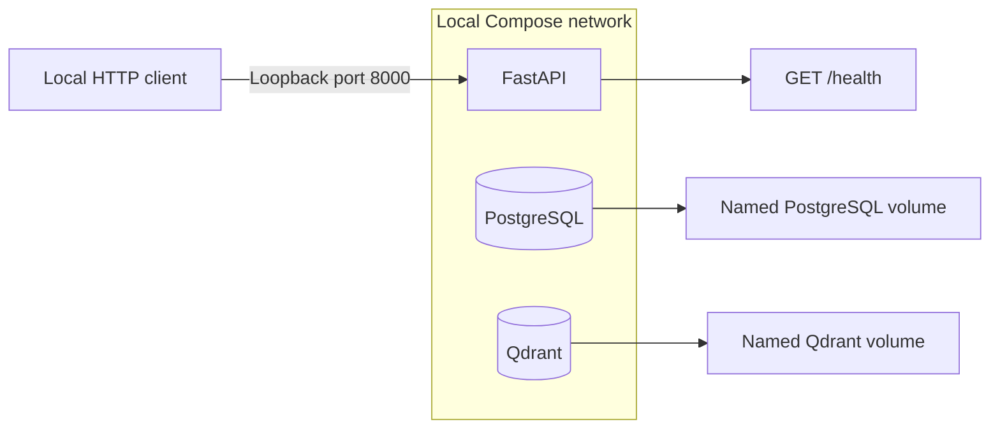
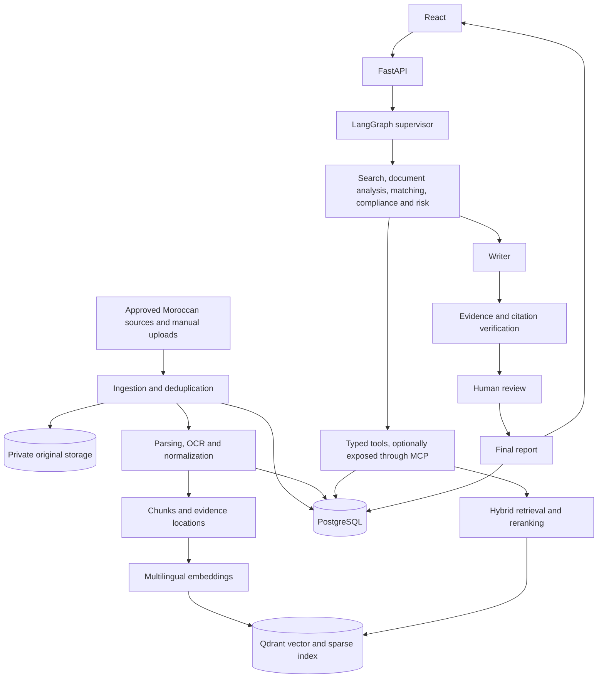

# Architecture

## Phase 0 deployment

The health route is a process liveness probe. It runs without datastore clients, credentials or model weights. The three containers use independent healthchecks and the API can also run directly under Uvicorn. Host bindings are loopback-only. The PostgreSQL and Qdrant healthchecks measure server availability independently.

## Target application

## Boundaries and data contracts

- **Transport and application.** FastAPI validates transport schemas and calls use cases. Shared contracts use typed Python and Pydantic. SQLAlchemy repositories and Alembic migrations enter with persistent workflows.
- **Ingestion and parsing.** Store immutable originals behind a storage interface. Record hash, source URL and revision. Keep parser versions and original page or section offsets so reprocessing remains traceable.
- **Retrieval.** PostgreSQL owns business entities. Qdrant stores derived, rebuildable indices keyed by document version, chunk and embedding model. Filter by tender and access scope before ranking. Compare BGE-M3 with smaller multilingual encoders on the same corpus.
- **Generation.** Define provider-independent generation and structured output interfaces when Phase 3 needs them. Ollama is the first candidate. Keep prompts, schema validation and citation checks outside provider adapters.
- **Orchestration.** LangGraph manages explicit state and branching. Writing feeds verification. Missing or contested evidence routes to a human review state. A review may return the draft for revision before publishing. MCP exposes existing use cases through validated, scoped contracts.
- **Operations.** Use PostgreSQL for durable metadata and review state. Consider Redis only for demonstrated queue or cache needs. Redacted Langfuse traces and evaluation datasets enter with Phase 8.

## Trade-offs

FastAPI with plain Uvicorn keeps the API footprint small and generates an OpenAPI contract. Flask offers a simple server but would require additional schema and documentation work. Django offers integrated persistence and administration that become valuable when a larger web application is needed.

PostgreSQL fits relational provenance and analysis history. SQLite is a practical single-user alternative for early fixtures. Qdrant offers a dedicated vector and sparse retrieval layer. PostgreSQL with pgvector would simplify deployment and remains a candidate if operational overhead outweighs the benefit of a separate index.

A modular monolith keeps application boundaries visible and reduces operational overhead. Introduce independent workers only when parsing or model execution requires resource isolation or durable background jobs.
